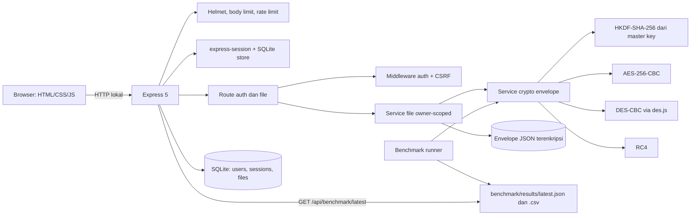

# CampusVault

**Penyimpanan dokumen lokal terenkripsi untuk organisasi kampus**

CampusVault adalah prototipe akademik untuk menyimpan dokumen internal organisasi kampus, seperti data anggota, pemindaian identitas dummy, proposal, laporan, dan dokumentasi kegiatan. Isi file dienkripsi sebelum disimpan. Setiap pengguna hanya dapat mengakses file miliknya sendiri.

> **Gunakan hanya data dummy untuk demonstrasi.** Jangan mengunggah KTP, data anggota, surat, foto, video, atau dokumen pribadi yang nyata. Repositori ini tidak boleh berisi data personal, database runtime, ciphertext runtime, atau secret.

> **Batas prototipe.** AES-CBC adalah pilihan utama. DES dan RC4 hanya tersedia untuk perbandingan akademik dan **tidak aman** untuk penggunaan nyata. CampusVault adalah prototipe akademik lokal, bukan layanan produksi dan bukan klaim kepatuhan hukum.

---

## 1. Skenario dan Pengguna

Sasaran pengguna adalah administrator organisasi kampus, misalnya BEM, himpunan mahasiswa, atau panitia kegiatan, yang perlu menyimpan dokumen operasional privat secara lokal.

Contoh kategori dokumen:

- data anggota sintetis dalam CSV;
- pemindaian identitas dummy dalam PDF, JPG, JPEG, atau PNG;
- surat kerja sama, proposal, daftar peserta, dan laporan keuangan dalam PDF, DOCX, XLSX, atau PPTX;
- dokumentasi kegiatan internal dalam MP4 atau WebM.

Model akses hanya memiliki satu peran: **pengguna terautentikasi**. Tidak ada workspace organisasi, berbagi file, RBAC, atau admin. Kepemilikan file selalu berasal dari sesi server, bukan dari input klien.

## 2. Fitur

- Registrasi dan login dengan username/password; email tidak diperlukan.
- Sesi server-side persisten di SQLite dengan cookie `HttpOnly`, `SameSite=Lax`, dan `Secure` pada mode production.
- Password di-hash dengan `crypto.scrypt`, salt acak per password, dan string hash berversi.
- Enkripsi isi file dengan AES-256-CBC, DES-CBC tunggal, atau RC4.
- Integritas ciphertext dengan HMAC-SHA-256 menggunakan pola **encrypt-then-MAC**.
- Envelope JSON berversi dengan salt acak per file dan kunci turunan HKDF-SHA-256.
- Validasi ekstensi, MIME type, dan magic byte; batas unggah 25 MiB.
- Daftar file hanya berisi milik pengguna yang sedang login.
- Unduh plaintext hasil dekripsi, unduh envelope ciphertext, dan hapus file milik sendiri.
- Benchmark AES/DES/RC4 yang reproducible dengan output JSON dan CSV dari eksekusi nyata.
- Ringkasan benchmark di UI tanpa angka performa yang di-hard-code.
- Security header, rate limit autentikasi/API, CSRF token, error generik, dan rendering DOM yang aman.
- Migrasi database berversi dan test otomatis dengan direktori/database sementara.

## 3. Arsitektur



Alur unggah:

1. Multer menahan file di memori dengan batas 25 MiB; tidak ada plaintext yang ditulis ke disk.
2. Ekstensi, MIME, signature, dan ukuran divalidasi.
3. Service kriptografi membuat salt dan IV acak, menurunkan kunci enkripsi/MAC, lalu membuat envelope.
4. Envelope ditulis ke file sementara dengan nama acak.
5. Metadata ditulis dalam transaksi SQLite.
6. File sementara di-rename secara atomik ke lokasi akhir.
7. Jika salah satu langkah gagal, file sementara dan metadata yang sudah sempat dibuat dibersihkan.

Disk path, salt, IV, HMAC, hash internal, dan key material tidak dikembalikan oleh API daftar file.

## 4. Prasyarat

- **Node.js 22 atau lebih baru** (`engines.node` di `package.json`).
- **Diverifikasi pada Node.js v24.21.0 dan npm 11.19.0.**
- npm dan Git.
- Tidak memerlukan server database eksternal; SQLite disimpan sebagai file lokal.
- Tidak memerlukan layanan cloud atau key-management service.

## 5. Instalasi Bersih

```bash
git clone <url-repositori-anda>
cd secure-file-app
npm ci
cp .env.example .env
```

Di PowerShell Windows:

```powershell
Copy-Item .env.example .env
npm.cmd ci
```

Jika PowerShell memblokir `npm.ps1`, gunakan `npm.cmd` untuk semua perintah npm.

Setelah `.env` dibuat, isi dua secret dengan nilai acak baru. Jalankan perintah berikut dua kali dan masukkan hasilnya ke variabel yang sesuai:

```bash
node -e "console.log(require('node:crypto').randomBytes(48).toString('base64'))"
```

- hasil pertama untuk `CAMPUSVAULT_MASTER_KEY`;
- hasil kedua untuk `SESSION_SECRET`.

Jangan menggunakan nilai contoh, jangan memakai ulang kunci lama, dan jangan commit `.env`. File `.env` sudah diabaikan oleh `.gitignore`.

## 6. Variabel Environment

Nama variabel dan panduan tersedia di `.env.example`; file tersebut tidak berisi nilai secret.

| Variabel | Wajib | Keterangan |
| --- | --- | --- |
| `NODE_ENV` | Tidak | Default `development`. Nilai `production` mengaktifkan cookie `Secure`. |
| `HOST` | Tidak | Default `127.0.0.1`. |
| `PORT` | Tidak | Default `3000`. |
| `CAMPUSVAULT_MASTER_KEY` | **Ya** | Base64 kanonis dari minimal 32 byte acak; disarankan 48 byte. Dipakai untuk HKDF, bukan disimpan di database. |
| `SESSION_SECRET` | **Ya** | Minimal 32 karakter acak. Dipakai untuk menandatangani cookie sesi. |
| `DATABASE_PATH` | Tidak | Default `./server/data/database.sqlite`. |
| `STORAGE_DIR` | Tidak | Default `./server/data/storage`. |
| `BENCHMARK_RESULTS_DIR` | Tidak | Default `./benchmark/results`. |
| `SESSION_TTL_MS` | Tidak | Default `7200000` (2 jam), sliding expiration. |
| `MAX_UPLOAD_BYTES` | Tidak | Default dan batas keras `26214400` (25 MiB). Nilai lebih besar dipotong ke batas keras. |
| `AUTH_RATE_LIMIT_MAX` | Tidak | Default 20 percobaan autentikasi per window. |
| `API_RATE_LIMIT_MAX` | Tidak | Default 300 request API per window. |
| `RATE_LIMIT_WINDOW_MS` | Tidak | Default 900000 (15 menit). |

Aplikasi gagal startup dengan pesan aman jika master key tidak ada, bukan Base64 kanonis, kurang dari 32 byte, atau jika `SESSION_SECRET` kurang dari 32 karakter.

## 7. Migrasi dan Menjalankan Aplikasi

```bash
npm run migrate
npm start
```

`npm run migrate` membuat database baru dan menerapkan migrasi SQL secara berurutan. Migrasi bersifat idempotent: migrasi yang sudah tercatat di `schema_migrations` tidak dijalankan ulang. Server juga menjalankan migrasi saat startup.

Buka `http://127.0.0.1:3000`. Hentikan server dengan `Ctrl+C`.

Mode pengembangan:

```bash
npm run dev
```

Perintah lain:

```bash
npm run lint       # ESLint
npm test           # Node.js built-in test runner
npm run check      # lint + test
npm run benchmark  # benchmark kriptografi
npm run audit      # npm audit --omit=dev
```

## 8. Format File dan Batas Ukuran

Maksimum **25 MiB (26.214.400 byte)** per file. File kosong ditolak.

| Kategori | Ekstensi | MIME yang diterima |
| --- | --- | --- |
| Data personal terstruktur | `.csv` | `text/csv`, `application/csv`, `application/vnd.ms-excel`, `text/plain` |
| Dokumen/identitas | `.pdf` | `application/pdf` |
| Gambar | `.jpg`, `.jpeg` | `image/jpeg` |
| Gambar | `.png` | `image/png` |
| Office | `.docx` | `application/vnd.openxmlformats-officedocument.wordprocessingml.document` |
| Office | `.xlsx` | `application/vnd.openxmlformats-officedocument.spreadsheetml.sheet` |
| Office | `.pptx` | `application/vnd.openxmlformats-officedocument.presentationml.presentation` |
| Video | `.mp4` | `video/mp4` |
| Video | `.webm` | `video/webm` |

Selain ekstensi dan MIME, aplikasi memeriksa signature yang dapat dikenali:

- PDF: `%PDF-`;
- JPEG: `FF D8 FF`;
- PNG: signature PNG;
- DOCX/XLSX/PPTX: signature arsip ZIP;
- MP4: `ftyp` pada offset 4;
- WebM: signature EBML;
- CSV: tidak mengandung byte NUL dan valid UTF-8.

Pemeriksaan signature ini adalah pertahanan dasar, bukan pemindaian antivirus atau validasi struktur dokumen secara menyeluruh.

Nama file asli hanya digunakan untuk tampilan dan `Content-Disposition` setelah disanitasi. Nama fisik selalu berupa identifier acak, misalnya `<48 hex>.json`. Direktori storage tidak pernah disajikan sebagai static content.

## 9. Autentikasi dan Akses Owner-Only

- Username dinormalisasi ke huruf kecil, panjang 3-32 karakter, dan hanya boleh berisi huruf, angka, titik, garis bawah, atau tanda hubung.
- Password harus 10-128 karakter. Batas atas diperiksa sebelum scrypt untuk mengurangi risiko denial-of-service.
- Password disimpan sebagai string berversi `scrypt$1$N$r$p$salt$hash`; salt 16 byte dan derived key 64 byte.
- Login yang gagal selalu memberi pesan generik. Untuk username yang tidak ada, server tetap menjalankan scrypt terhadap dummy hash agar timing tidak membocorkan keberadaan akun.
- Session ID diregenerasi setelah login. Logout menghancurkan sesi server dan menghapus cookie.
- Semua route file memakai middleware autentikasi, lalu CSRF, lalu query dengan `owner_id = sesi.userId` **dan** `id = parameter`.
- Pengguna lain menerima **404** yang sama untuk file yang tidak ada maupun file milik pengguna lain, sehingga ID file tidak dapat dipakai untuk enumerasi.
- API tidak menerima `username` atau `owner_id` dari klien sebagai dasar kepemilikan.
- Cookie: `HttpOnly`, `SameSite=Lax`, `Path=/`, `Max-Age` sesuai TTL; `Secure` hanya aktif pada `NODE_ENV=production`.
- CSRF: token per sesi dikirim pada header `X-CSRF-Token` untuk request yang mengubah state.

Catatan: `Secure` pada production memerlukan HTTPS. Untuk demo lokal HTTP, gunakan `NODE_ENV=development`.

## 10. Envelope dan Derivasi Kunci

Master secret dibaca dari `CAMPUSVAULT_MASTER_KEY`, harus Base64 kanonis dengan minimal 32 byte setelah decode. Secret tidak ditulis ke source, database, fixture, README, atau `.env.example`.

Setiap enkripsi membuat **salt acak 32 byte**. Kunci enkripsi dan kunci MAC diturunkan terpisah dengan HKDF-SHA-256 dan label domain:

```text
campusvault:v1:aes:enc
campusvault:v1:aes:mac
campusvault:v1:des:enc
campusvault:v1:des:mac
campusvault:v1:rc4:enc
campusvault:v1:rc4:mac
```

| Algoritma | Mode | Panjang kunci enkripsi | IV |
| --- | --- | --- | --- |
| AES | CBC | 32 byte | 16 byte acak |
| DES | CBC | 8 byte | 8 byte acak |
| RC4 | STREAM | 32 byte | tidak ada (`null`) |

Envelope disimpan sebagai JSON UTF-8 dengan field:

```json
{
  "version": 1,
  "algorithm": "AES",
  "mode": "CBC",
  "kdf": "HKDF-SHA256",
  "salt": "base64",
  "iv": "base64",
  "ciphertext": "base64",
  "plaintext_sha256": "hex",
  "plaintext_size": 1234,
  "hmac": "base64"
}
```

Aturan MAC:

- HMAC-SHA-256 dihitung dengan kunci MAC hasil HKDF.
- Input MAC adalah JSON kanonis UTF-8 dari **semua field kecuali `hmac`**, dengan key objek diurutkan secara leksikografis pada setiap level.
- Field yang diautentikasi mencakup `version`, `algorithm`, `mode`, `kdf`, `salt`, `iv`, `ciphertext`, `plaintext_sha256`, dan `plaintext_size`.
- Parser menolak field tambahan, field hilang, versi/algoritma/mode/KDF tidak dikenal, Base64 tidak kanonis, panjang field yang salah, ciphertext kosong, panjang blok CBC yang tidak valid, dan envelope di atas 40 MiB.
- HMAC diverifikasi dengan `crypto.timingSafeEqual` **sebelum dekripsi**.
- Metadata database (algoritma, mode, versi envelope, ukuran, SHA-256) harus cocok dengan envelope yang sudah diautentikasi.

Tidak ada per-file DEK wrapping dan tidak ada rotasi kunci otomatis pada scope ini.

## 11. Keputusan AES, DES, dan RC4

**AES-256-CBC** adalah pilihan default dan rekomendasi prototipe. Node.js `crypto` menyediakan AES-256-CBC dengan IV acak 16 byte per enkripsi dan padding PKCS#7 melalui runtime. ECB tidak digunakan dan tidak disediakan sebagai fallback.

**DES-CBC tunggal** digunakan hanya untuk demonstrasi akademik. Implementasi memakai package `des.js` dengan `des.js.CBC.instantiate(des.js.DES)`, key 8 byte, IV 8 byte, dan padding PKCS#7. Ini adalah single DES, bukan DES-EDE, 2-key 3DES, atau 3-key 3DES. OpenSSL legacy provider tidak diaktifkan. Package dipilih karena menyediakan DES-CBC JavaScript yang terisolasi dan dapat diuji terhadap vektor FIPS.

**RC4** juga hanya untuk demonstrasi akademik. Implementasi RC4 ringkas memakai key turunan 32 byte per envelope, tanpa KDF passphrase legacy CryptoJS. Implementasi diuji dengan vektor referensi.

> **Peringatan:** DES dan RC4 adalah algoritma legacy yang tidak aman untuk data nyata. Hasil benchmark yang lebih cepat atau lebih kecil tidak membuat keduanya layak dipakai di produksi. Gunakan AES untuk prototipe ini.

## 12. Integritas dan Pemulihan

Saat upload, server menyimpan SHA-256 dan ukuran byte asli di metadata dan juga mengikatnya di dalam envelope yang diautentikasi.

Saat restore, urutannya adalah:

1. cek kepemilikan berdasarkan sesi;
2. baca dan validasi struktur envelope;
3. verifikasi HMAC sebelum dekripsi;
4. dekripsi;
5. bandingkan ukuran plaintext dengan metadata/envelope;
6. hitung SHA-256 plaintext dan bandingkan dengan nilai yang diautentikasi;
7. kirim plaintext hanya jika seluruh pemeriksaan lulus.

Jika ada field yang diubah, HMAC gagal dan server mengembalikan error integritas generik tanpa plaintext. SHA-256 adalah pemeriksaan korektness tambahan dan tidak menggantikan HMAC.

## 13. API Ringkas

| Method | Path | Akses | Keterangan |
| --- | --- | --- | --- |
| `GET` | `/api/health` | Publik | Status aplikasi. |
| `GET` | `/api/auth/csrf` | Publik | Token CSRF untuk sesi. |
| `GET` | `/api/auth/me` | Publik | Status sesi dan user saat ini. |
| `POST` | `/api/auth/register` | Publik + CSRF | Membuat akun; `201`. |
| `POST` | `/api/auth/login` | Publik + CSRF | Login dan regenerasi sesi. |
| `POST` | `/api/auth/logout` | Sesi + CSRF | Menghancurkan sesi. |
| `GET` | `/api/files` | Sesi | Daftar file milik sendiri. |
| `POST` | `/api/files` | Sesi + CSRF | Upload multipart (`file`, `algorithm`); `201`. |
| `GET` | `/api/files/:id/download` | Sesi | Unduh plaintext hasil dekripsi. |
| `GET` | `/api/files/:id/ciphertext` | Sesi | Unduh envelope ciphertext JSON. |
| `DELETE` | `/api/files/:id` | Sesi + CSRF | Hapus metadata dan ciphertext. |
| `GET` | `/api/benchmark/latest` | Sesi | Hasil benchmark terbaru atau `404`. |

Error menggunakan bentuk konsisten:

```json
{
  "error": {
    "code": "INTEGRITY_CHECK_FAILED",
    "message": "File tidak dapat dipulihkan karena pemeriksaan integritas gagal."
  }
}
```

Status yang digunakan mencakup `400`, `401`, `403`, `404`, `409`, `413`, `415`, `422`, `429`, dan `500` sesuai jenis kegagalan. Error `500` tidak menyertakan stack trace atau secret.

## 14. Test

```bash
npm test
```

Test memakai Node.js built-in test runner, direktori sementara, database SQLite terpisah, dan master key/session secret acak per konteks. Test tidak menyentuh database atau storage runtime yang dipakai aplikasi demo.

Cakupan utama:

- registrasi, validasi username/password, duplikasi username, login generik, flag cookie, rotasi sesi, logout, dan `401`;
- rate limit autentikasi;
- IDOR dua pengguna untuk list, plaintext, ciphertext, dan delete;
- validasi unggahan untuk semua kategori, MIME/signature yang tidak cocok, file terlalu besar, nama file berbahaya, dan cleanup plaintext sementara;
- round-trip AES/DES/RC4 untuk teks, biner, dan keempat fixture benchmark;
- vektor uji AES NIST, DES FIPS, dan RC4;
- HMAC dan penolakan perubahan version, algorithm, mode, salt, IV, ciphertext, hash, ukuran, dan HMAC;
- verifikasi HMAC sebelum dekripsi;
- korektness SHA-256 dan ukuran hasil unduhan;
- perhitungan mean, median, min, max, sample standard deviation, throughput, overhead, CSV, dan warm-up;
- UI safety: nama file dirender dengan `textContent`, warning DES/RC4 terlihat, dan tidak ada UI dekripsi eksternal.

Perintah tambahan:

```bash
npm run lint
npm run check
npm run audit
```

## 15. Benchmark

Benchmark mengukur **pipeline kriptografi**, bukan HTTP, network, rendering browser, operasi database, atau penulisan file final.

```bash
npm run benchmark
```

Konfigurasi:

- 4 fixture dummy;
- algoritma AES, DES, dan RC4 pada byte yang sama untuk setiap fixture;
- 1 warm-up dan 10 iterasi terukur per kombinasi fixture-algoritma;
- urutan algoritma dirotasi secara deterministik untuk mengurangi bias urutan;
- timer `node:perf_hooks` `performance.now()`;
- setiap iterasi melakukan enkripsi + HMAC, verifikasi HMAC + dekripsi, pemeriksaan ukuran dan SHA-256;
- derivasi kunci HKDF dengan salt acak per envelope termasuk dalam pengukuran dan dicatat di metadata;
- total baris: 4 fixture × 3 algoritma × 11 ronde = **132 baris** (12 warm-up, 120 measured);
- agregat: **12 kombinasi** fixture-algoritma.

Metrik per baris mencakup fixture, kategori, MIME, ukuran, SHA-256, algoritma, mode, nomor iterasi, fase warm-up/measured, waktu enkripsi+MAC, waktu verifikasi+dekripsi, total waktu, ukuran envelope, overhead byte/persentase, throughput enkripsi/dekripsi, status round-trip, versi runtime, platform, CPU, dan timestamp.

Agregat mencakup mean, median, minimum, maximum, sample standard deviation (`n-1`), jumlah sukses/gagal, throughput, ukuran envelope, overhead, dan status korektness. Iterasi yang gagal tidak dihitung sebagai sukses.

Rumus:

```text
overhead_bytes = encrypted_envelope_size_bytes - original_size_bytes
overhead_percentage = (overhead_bytes / original_size_bytes) * 100
throughput_MiB_per_second = (original_size_bytes / 1,048,576) / elapsed_seconds
```

Output nyata ditulis ke:

```text
benchmark/results/latest.json
benchmark/results/latest.csv
```

Kedua file diabaikan Git karena nilainya bergantung pada mesin dan runtime. UI membaca hasil melalui endpoint terautentikasi dan menampilkan empty state jika benchmark belum pernah dijalankan. Schema output ada di `benchmark/schema.json` dan tidak memuat nilai pengukuran.

### Fixture benchmark

Manifest lengkap ada di `benchmark/fixtures/manifest.json`.

| Fixture | Kategori | Tipe | Byte | SHA-256 |
| --- | --- | --- | ---: | --- |
| `personal-data.csv` | personal | `text/csv` | 8704 | `a94101af8827e742bdbbd4aea9fbea7a4548485523b55eb35c3ae74c89a46725` |
| `identity-scan.png` | identity | `image/png` | 3170 | `5b022bc5ff703b3d46be8f2372f5305a931b755eeed32a8496b137d628a547cc` |
| `office-document.docx` | office | `application/vnd.openxmlformats-officedocument.wordprocessingml.document` | 980 | `ccbfb571c76a333e7ef21b686156ce83679f91804deda0245bb27ba4d84629ff` |
| `video-sample.mp4` | video | `video/mp4` | 1883 | `1fae6b55f2150fc152fb722142cae9de4badea88e899b2c05472f9c92dd59857` |

Semua fixture bersifat sintetis/dummy dan tidak memuat identitas atau data personal nyata. Runner memverifikasi ukuran dan SHA-256 fixture terhadap manifest sebelum mengukur; ketidakcocokan menghentikan benchmark.

### Cara membaca hasil

- Waktu lebih rendah atau throughput lebih tinggi berarti pemrosesan lebih cepat **pada mesin dan runtime yang tercatat**.
- Envelope lebih besar berarti overhead penyimpanan lebih besar, terutama untuk file kecil.
- Round-trip benar dan penolakan tamper adalah syarat korektness, bukan metrik performa opsional.
- Hasil hanya berlaku untuk mesin, versi Node.js, dan fixture yang tercatat.
- AES tetap rekomendasi prototipe; hasil DES/RC4 bukan bukti keamanan.

## 16. Alur Demo Lokal

1. Siapkan `.env`, jalankan `npm run migrate`, lalu `npm start`.
2. Buka `http://127.0.0.1:3000`.
3. Buat akun demo dengan username dummy, misalnya `demo_anggota`, dan password unik minimal 10 karakter.
4. Login sebagai akun tersebut.
5. Unggah salah satu file dari `benchmark/fixtures/`, pilih AES-256-CBC, lalu klik **Enkripsi & simpan**.
6. Perhatikan file muncul di daftar milik pengguna. Unduh plaintext untuk memeriksa hasil pemulihan; unduh **Ciphertext** untuk melihat envelope JSON.
7. Jalankan `npm run benchmark`, lalu klik **Muat ulang** pada panel benchmark untuk melihat hasil nyata mesin tersebut.
8. Buat akun dummy kedua di jendela private/incognito, login, dan pastikan daftar file kosong. Jika ID file pengguna pertama dicoba, server mengembalikan `404`.
9. Hapus file sebagai pemiliknya dan pastikan metadata serta ciphertext hilang.
10. Logout, lalu hentikan server dengan `Ctrl+C`.

Jangan mengunggah data nyata pada langkah mana pun.

## 17. Keamanan, Privasi, dan Batasan Cakupan

Kontrol yang sudah diterapkan:

- Helmet security headers dan `X-Powered-By` dinonaktifkan.
- Body limit 32 KiB untuk JSON/urlencoded; upload dibatasi 25 MiB.
- Rate limit untuk autentikasi dan API.
- CSRF token terikat sesi untuk operasi yang mengubah state.
- Cookie `HttpOnly`, `SameSite=Lax`, `Secure` pada production.
- Session store SQLite, bukan in-memory default.
- Query owner-scoped dan respons `404` konsisten.
- Password scrypt dengan salt acak dan perbandingan timing-safe.
- HMAC-SHA-256 encrypt-then-MAC dan verifikasi sebelum dekripsi.
- Parser envelope fail-closed dan batas ukuran envelope.
- Nama file disanitasi; storage tidak disajikan statis; UI memakai `textContent`.
- Error klien generik; log tidak memuat password, cookie, key, plaintext, atau HMAC.
- Tidak ada endpoint dekripsi eksternal.

Batas yang diketahui:

- Aplikasi hanya untuk demonstrasi lokal, bukan produksi.
- Satu master key global; belum ada per-file DEK wrapping atau rotasi kunci otomatis.
- Metadata file di SQLite tidak dienkripsi; yang dilindungi adalah isi file dan integritas envelope.
- Server dapat mendekripsi file; ini bukan end-to-end encryption.
- Rate limit disimpan di memori proses dan kembali ke nol saat server restart.
- Sesi persisten, tetapi aplikasi berjalan sebagai satu proses lokal.
- Validasi signature hanya memeriksa magic byte, bukan struktur internal dokumen.
- Tidak ada antivirus, preview dokumen, transcoding video, atau streaming.
- Tidak ada MFA, reset password, verifikasi email, SSO, atau sharing.
- Tidak ada backup/restore otomatis atau high availability.
- Tidak ada TLS bawaan; production membutuhkan reverse proxy HTTPS.
- Hasil benchmark adalah microbenchmark dan tidak mewakili performa end-to-end.
- Sampai rewrite riwayat Git dilakukan secara terkoordinasi, data runtime lama dan secret lama masih dapat berada di riwayat remote. Tree saat ini sudah dibersihkan, tetapi riwayat lama harus dianggap berisiko.

## 18. Hubungan dengan UU PDP dan GDPR

Bagian ini adalah rationale desain, **bukan klaim kepatuhan hukum**.

- **Data minimization:** akun hanya membutuhkan username dan password; tidak ada email wajib.
- **Purpose limitation:** file disimpan untuk penyimpanan privat dan evaluasi cipher.
- **Access limitation:** hanya pemilik yang terautentikasi dapat mengakses file; kepemilikan berasal dari sesi.
- **Retention control:** pemilik dapat menghapus file dan ciphertext terkait.
- **Confidentiality dan integrity:** isi file dienkripsi dan envelope diautentikasi dengan HMAC.
- **Dummy data only:** demonstrasi tidak boleh memakai data personal nyata.
- **Transparency dan accountability:** README, UI, dan benchmark menjelaskan batas prototipe serta metode pengukuran.

Prinsip GDPR yang relevan secara konseptual meliputi data minimisation, storage limitation, integrity and confidentiality, dan accountability. UU No. 27 Tahun 2022 tentang Pelindungan Data Pribadi juga menekankan pemrosesan yang terbatas, aman, dan dapat dipertanggungjawabkan. Enkripsi saja tidak menjamin kepatuhan; kebijakan retensi, kontrol akses, audit, dan tata kelola organisasi tetap diperlukan.

## 19. Struktur Proyek

```text
server/
  app.js                 # Express app, session, rate limit, static UI
  server.js              # entrypoint, startup, shutdown
  config.js              # validasi environment
  db.js                  # SQLite helper dan migrasi
  migrate.js             # CLI migrasi
  migrations/            # migrasi SQL berversi
  session-store.js       # express-session store di SQLite
  crypto/                # AES, DES, RC4, HKDF, envelope
  middleware/            # auth, CSRF, error
  routes/                # auth, files, benchmark
  services/              # user dan file service
  utils/                 # validasi file dan async handler
public/                  # UI vanilla HTML/CSS/JS
benchmark/
  fixtures/              # empat fixture dummy + manifest
  lib.js                 # statistik dan CSV
  run.js                 # runner benchmark
  schema.json            # schema output benchmark v1
  results/               # output runtime (diabaikan Git)
test/                    # test Node.js
docs/                    # dokumentasi remediasi riwayat
```

## 20. Repositori dan Remediasi Riwayat

File runtime, database, ciphertext, plaintext, `.env`, `node_modules`, dan output benchmark tidak boleh di-commit. `.gitignore` sudah mencakup path tersebut.

Secret lama dianggap **kompromi permanen** dan tidak boleh dipakai ulang. Panduan rewrite riwayat yang terkoordinasi, termasuk perintah `git filter-repo`, verifikasi secret scan, dan langkah re-clone kolaborator, tersedia di [`docs/history-remediation.md`](docs/history-remediation.md).

Jangan force-push sebelum seluruh kolaborator dikoordinasikan. Rewrite riwayat mengubah commit hash dan mengharuskan kolaborator melakukan re-clone atau reset yang hati-hati.

## 21. Kontribusi dan Panduan Commit

- Buat branch terpisah untuk perubahan tugas.
- Jalankan `npm run check` sebelum commit.
- Jangan commit `.env`, database, storage, output benchmark, log, atau data personal.
- Gunakan commit kecil dan fokus, bukan satu commit "final update".
- Sertakan penjelasan perubahan keamanan dan alasan desain pada pesan commit/PR.
- Jangan menambahkan pengukuran benchmark yang tidak dijalankan sendiri.
- Untuk laporan akademik, gunakan hasil nyata dari `benchmark/results/latest.json` dan cantumkan environment mesinnya.
- Kontribusi tim sebaiknya diverifikasi dengan riwayat Git yang sebenarnya (`git shortlog -sn`), bukan direkayasa.

Contoh pesan commit:

```text
chore: remove tracked runtime data and add gitignore
feat(auth): add persistent server-side sessions
feat(files): enforce owner-scoped file access
feat(crypto): add versioned authenticated envelope
feat(benchmark): add reproducible cipher benchmark
security: add csrf rate limiting and headers
test: cover idor tampering and upload cleanup
docs: rewrite setup and benchmark methodology
```

---

**Status:** Prototipe akademik lokal. Tidak untuk produksi, tidak untuk data pribadi nyata, dan bukan sertifikasi kepatuhan UU PDP/GDPR.
